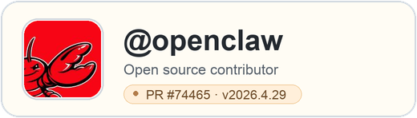

## Hi, I'm Carl 🌱

I teach English and grow practical AI-agent systems for learning, knowledge work, and developer workflows.

Currently building [**Taogen**](https://github.com/CaoYuhaoCarl/Taogen) — a Pi-based agent garden for prompts, extensions, subagents, and P2P workflow experiments.

- 🌿 Exploring: Google ADK, LangGraph, and Pi Agent
- ✍️ Thinking with: Obsidian and Excalidraw
- 🤝 Open source: [OpenClaw](https://github.com/openclaw/openclaw) contributor — [PR #74465](https://github.com/openclaw/openclaw/pull/74465#event-24999551397) merged and released in `v2026.4.29`
- 🐶 Motto: Ideas take root. Agents grow.

---

## Agent Stack

## Contribution

[PR #74465](https://github.com/openclaw/openclaw/pull/74465#event-24999551397) — `fix(google): prevent empty contents error for gemini`; merged into `main` and released in `v2026.4.29`.

---

## Connect

---

<b>GitHub Stats</b>

 

---

## Recent Activity

<!--START_SECTION:activity-->
1. 🚀 Published release [v0.4.0](https://github.com/CaoYuhaoCarl/learnmate-personalized-english/releases/tag/v0.4.0) in [CaoYuhaoCarl/learnmate-personalized-english](https://github.com/CaoYuhaoCarl/learnmate-personalized-english)
2. 🎉 Merged PR [#12](https://github.com/CaoYuhaoCarl/learnmate-personalized-english/pull/12) — `[codex] localize report section headings` in [CaoYuhaoCarl/learnmate-personalized-english](https://github.com/CaoYuhaoCarl/learnmate-personalized-english)
3. 🎉 Merged PR [#11](https://github.com/CaoYuhaoCarl/learnmate-personalized-english/pull/11) — `[codex] document PDF export dependencies` in [CaoYuhaoCarl/learnmate-personalized-english](https://github.com/CaoYuhaoCarl/learnmate-personalized-english)
<!--END_SECTION:activity-->
