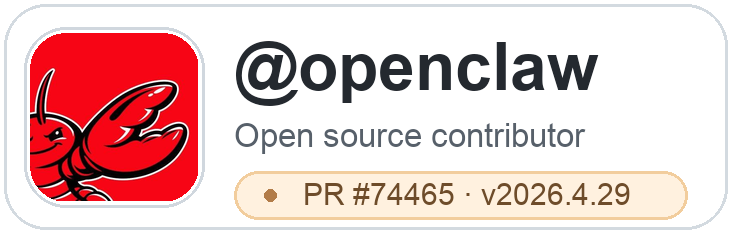
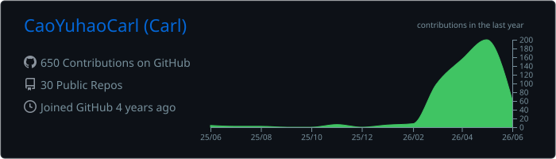
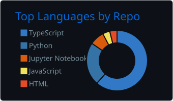
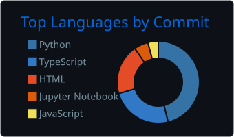

## Hi, I'm Carl 🌱

I teach English and grow practical AI-agent systems for learning, knowledge work, and developer workflows.

Currently building [**Taogen**](https://github.com/CaoYuhaoCarl/Taogen) — a Pi-based agent garden for prompts, extensions, subagents, and P2P workflow experiments.

- 🌿 Exploring: Google ADK, LangGraph, and Pi Agent
- ✍️ Thinking with: Obsidian and Excalidraw
- 🤝 Open source: [OpenClaw](https://github.com/openclaw/openclaw) contributor — [PR #74465](https://github.com/openclaw/openclaw/pull/74465#event-24999551397) merged and included in `v2026.4.29`
- 🐶 Motto: Ideas take root. Agents grow.

---

## Agent Stack

## Contribution

  <a href="https://github.com/openclaw/openclaw">
    <picture>
      <source media="(prefers-color-scheme: dark)" srcset="./assets/openclaw-card-outline-dark.png">
      <source media="(prefers-color-scheme: light)" srcset="./assets/openclaw-card-outline-light.png">
      
    </picture>
  </a>

  

    <a href="https://github.com/openclaw/openclaw/pull/74465#event-24999551397"><b>PR #74465</b></a> — fix(google): prevent empty contents error for gemini 
    merged into main · included in v2026.4.29
  

---

## Connect

---

## Recent Activity

<!--START_SECTION:activity-->
1. 🎉 Merged PR [#31](https://github.com/CaoYuhaoCarl/Taogen/pull/31) — `Add P2P any-initiator support scenario` in [CaoYuhaoCarl/Taogen](https://github.com/CaoYuhaoCarl/Taogen)
2. 🎉 Merged PR [#33](https://github.com/CaoYuhaoCarl/Taogen/pull/33) — `[codex] Add scenario skills demo` in [CaoYuhaoCarl/Taogen](https://github.com/CaoYuhaoCarl/Taogen)
3. 🎉 Merged PR [#32](https://github.com/CaoYuhaoCarl/Taogen/pull/32) — `Add comms-net await watchdog` in [CaoYuhaoCarl/Taogen](https://github.com/CaoYuhaoCarl/Taogen)
<!--END_SECTION:activity-->

---

<b>GitHub Stats</b>

 

