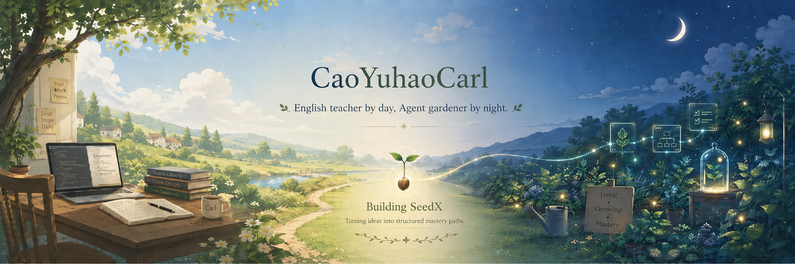
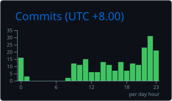
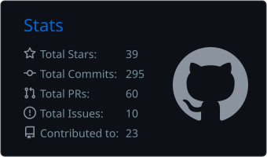

<div align="center">


</div>

---

## `> whoami`

```python
carl = {
    "name": "Cao Yuhao Carl",
    "role": "English teacher by day; agent gardener by night",
    "focus": "AI agents that turn questions into mastery paths",
    "systems": ["Taogen", "SeedX"],
    "principle": "Build workflows that are visible, evaluable, and useful after the demo.",
}
```

---

## Agent Engineering Stack

<div align="center">


[](https://github.com/google/adk-python)
[](https://pi.dev/)


</div>

## Workflow

<div align="center">


</div>

---

## Open Source Contributions

| Project | Contribution | Status |
| --- | --- | --- |
| [**OpenClaw**](https://github.com/openclaw/openclaw) | [PR #74465](https://github.com/openclaw/openclaw/pull/74465#event-24999551397) — `fix(google): prevent empty contents error for gemini`; merged into `main` and included in `v2026.4.29`. | Merged |

---

## GitHub Stats

<div align="center">


</div>

---

## When I Build (UTC+8)

<div align="center">




</div>

---

## Featured Projects

| Project | Stars | What it does |
| --- | --- | --- |
| [**Taogen**](https://github.com/CaoYuhaoCarl/Taogen) |  | A Pi-based agent garden for prompts, custom settings, extensions, orchestrated subagents, and P2P communication experiments. |
| [**SeedX**](https://github.com/CaoYuhaoCarl/seedx) |  | Turns messy questions into structured mastery paths with plans, exercises, evaluator loops, and transfer artifacts. |
| [**learnmate-personalized-english**](https://github.com/CaoYuhaoCarl/learnmate-personalized-english) |  | English coaching agents for writing feedback, speaking practice, vocabulary workouts, and adaptive reports. |
| [**wikix**](https://github.com/CaoYuhaoCarl/wikix) |  | An LLM-maintained wiki scaffold for source-backed personal and small-team knowledge systems. |

---

## Recent Activity

<!--START_SECTION:activity-->
1. 🚀 Published release [v0.4.0](https://github.com/CaoYuhaoCarl/learnmate-personalized-english/releases/tag/v0.4.0) in [CaoYuhaoCarl/learnmate-personalized-english](https://github.com/CaoYuhaoCarl/learnmate-personalized-english)
<!--END_SECTION:activity-->

---

## Connect

<div align="center">

[](https://github.com/CaoYuhaoCarl)
[](https://x.com/CaoYuhaoCarl)

</div>
